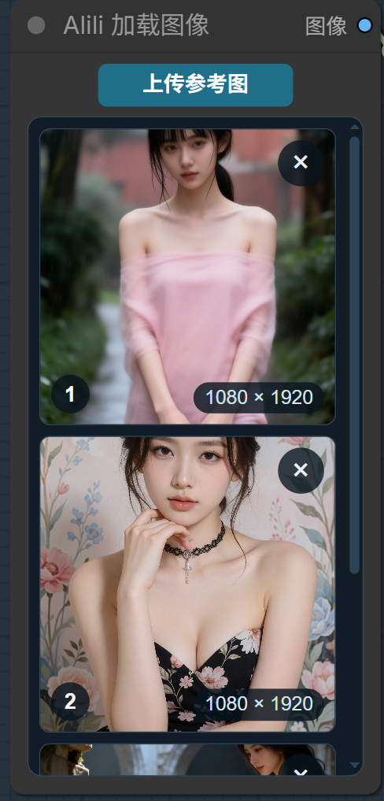
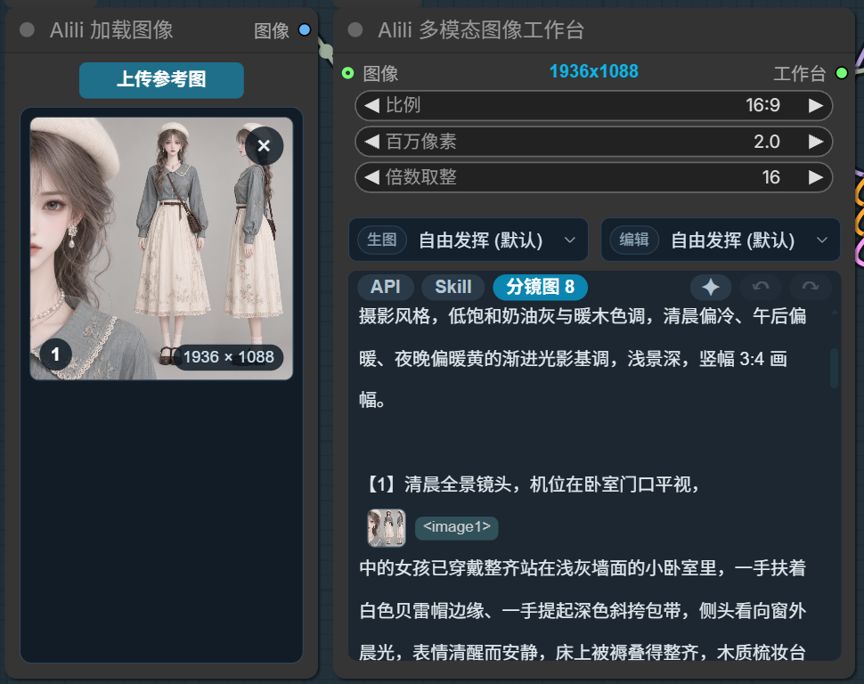
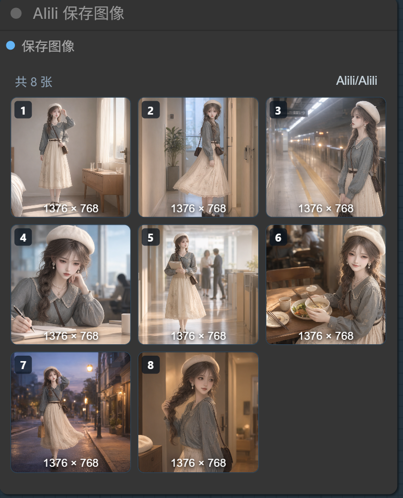
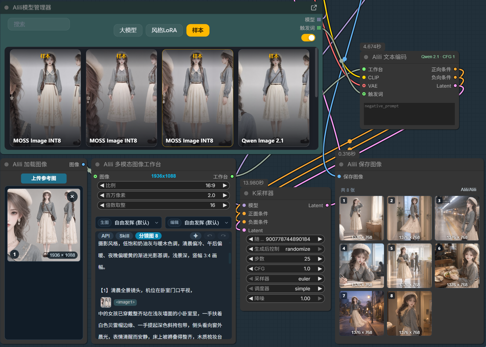

<div align="center">

# 🚀 Alili 多模态图像工作台 (Alili-Image-Workbench)

### ComfyUI 文生图 / 图生图一体化交互工作台 · 内置官方文本编码 · 多参考图 · 分镜 · 大模型提示词优化

[](https://github.com/comfyanonymous/ComfyUI)
[]()
[]()
[]()

**工作台只管「想画什么、画多大、参考哪几张图」；`Alili 文本编码` 把官方文本编码器吞进节点内部，按上游模型家族自动切换，不用手动换节点、也不用下拉菜单。**

[📺 B站视频教程](#-b站视频教程) • [✨ 功能亮点](#-功能亮点) • [🔌 自动切换怎么工作](#-自动切换怎么工作) • [🔧 节点与文件](#-节点与文件-)

---

</div>

## 📖 项目简介

**Alili 多模态图像工作台** 是一套围绕「图像生成」打磨的 ComfyUI 节点组，4 个节点各司其职：

- **Alili 加载图像** —— 收集最多 9 张参考图（顺序即 `<imageN>` 的 N）；
- **Alili 多模态图像工作台** —— 提示词 / 比例 / 百万像素 / 分镜 / 大模型推理的一体化面板；
- **Alili 文本编码** —— 内置官方文本编码器，自动按模型家族切换，输出正负条件 + 空 latent；
- **Alili 保存图像** —— 分镜多图按序排开、带工作流元数据。

外加一个调用大模型的**提示词优化后端**（文生图 / 图生图两套规则 + 可编辑模板库）。

作者：**阿里里**。免费向所有人开放使用。

---

## ✨ 功能亮点

### 🖼️ 参考图加载（只做收集）

- 最多 **9 张参考图**，支持按钮上传、拖入、粘贴、长按拖拽排序、点击插入 `<imageN>` 标签、缩略图右下角显示分辨率。
- **右键缩略图 → 复制图像文件**：后端把 `input` 目录里的原文件放进系统剪贴板，任意程序都能 Ctrl+V 粘贴为文件。
- 原样打包 `ALILI_IMAGES`，不缩放、不涂抹遮罩、不扩图、不做画板编辑。

### 🎛️ 一体化工作台面板

- 提示词、比例（自适应 / 1:1 / 4:3 / … / 21:9）、百万像素（0.1–16）、倍数取整（8–256，自己填）。
- **自适应比例**：有参考图时沿用首张图的原始宽高比，只取比例，尺寸按百万像素重算。
- **分镜出图**：`【1】镜头一 【2】镜头二 …` 自动拆镜，工作流按镜头依次生成。
- **图片引用统一**：`<image1>` / `图片1` / `图1` 统一成 `<imageN>`（LLM 反推也靠它指认参考图）。
- **大模型推理**：调用 LLM 扩写提示词或反推参考图，支持 10+ 平台与可编辑模板库。

### 🔌 Alili 文本编码：内置官方编码器，自动切换

输入只有 4 个连线口：**工作台 / CLIP / VAE / 触发词**（触发词保留，会前置到提示词）；节点下方有 **负向提示词** 多行文本框（CFG > 1 时生效）。
输出 3 个：**正向条件 / 负向条件 / Latent**。没有 9 个外部参考图口——参考图直接从工作台数据包里取。

- **不复制官方代码**：直接 import ComfyUI 内核里的官方节点类并调用它们的 `execute()`，官方升级自动跟随。
- **无参考图 → 普通 CLIP**；有参考图 → 按模型家族内部切换 Qwen Image 2.1 / MOSS-Image / MiniMax-H3-Image。
- **CFG ≤ 1 时负向条件零化**（官方 `ConditioningZeroOut`），> 1 才启用真实负向条件；CFG 由前端自动读下游采样器。
- **空 latent 规格也按家族切换**：通用 `空Latent图像`（4ch/8x）或 `空Latent图像（Flux2）`（128ch/16x）；Qwen 2.1 与 H3-Image 直接用官方返回的 latent。
- 想用外部空 latent 节点，把 KSampler 的 Latent 输入接到那个节点即可（本节点输出悬空，互不影响）。

### 💾 保存图像（分镜 / 元数据）

- 出图**一律直接写 `output` 目录**（带元数据），没有自动保存开关、没有临时图、没有手动保存按钮。
- 顶部一行：左侧「共 X 张」纯文字，右侧**直接显示保存路径**（如 `Alili/高清`），**双击原地编辑，不弹窗**。
- 每张缩略图底部显示分辨率（纯文字，无胶囊背景）；多图按到达顺序追加，一张不再覆盖一张。
- **右键任意图片 → 复制图像文件**：复制 `output` 目录里的原文件（不是重新编码的 PNG）。不做遮罩外还原、不做原图对比。

---

## 🔌 自动切换怎么工作

### 家族从哪来（不用和 Alili-Manager 合并）

`Alili 文本编码` 的 `CLIP` 输入连到 `CLIPLoader`。前端顺着这根连线往回找一层，读 CLIPLoader 的 `type` widget：

| CLIPLoader `type` | 内部走哪块 | 官方节点类 |
| :--- | :--- | :--- |
| `qwen_image` | [2] Qwen 2.1 | `TextEncodeQwenImage21` |
| `moss_image` | [3] MOSS-Image | `TextEncodeMOSSImageEdit` |
| `minimax` | [4] MiniMax-H3-Image | `MiniMaxH3ImageConditioning` |
| `flux2` | [1] 普通 CLIP + Flux2 空 latent | `EmptyFlux2LatentImage` |
| 其它 / 未识别 | [1] 普通 CLIP + 通用空 latent | `EmptyLatentImage` |

**Alili-Manager 切换模型卡片时会自动改写 CLIPLoader 的 `type`**（`ext/node.js` 的 `linkModel()`），所以"上游换了主模型"这件事已经反映在画布上了。两个插件通过 ComfyUI 的节点状态通信，各管各的，**不需要合并成一个插件**。识别结果会以只读文字画在节点上，没有下拉菜单。

### 参考图怎么喂给官方节点

工作台数据包里的 9 张图，在内部打包成官方 `images` 字典（键名规则各家不同，都由适配层处理）：

| 家族 | 键名 | 依据 |
| :--- | :--- | :--- |
| Qwen 2.1 | `image_1` … `image_9` | `TemplateNames`（1-based） |
| MOSS-Image | `image_0` … `image_8` | `TemplatePrefix`（0-based） |
| MiniMax-H3-Image | `image_0` … `image_8` | `TemplatePrefix`（0-based） |

三家都按键名里的数字排序，所以顺序天然对齐 `<image1>`…`<image9>`。

### 四个代码分区

所有适配集中在一个文件 `image_workbench/encoders.py`，注释标明哪块是哪家：

```
[1] 普通 CLIP      无参考图 / 未识别家族
[2] Qwen 2.1       comfy_extras.nodes_qwen.TextEncodeQwenImage21
[3] MOSS-Image     comfy_extras.nodes_moss_image.TextEncodeMOSSImageEdit
[4] H3-Image       comfy_extras.nodes_minimax_h3.MiniMaxH3ImageConditioning
[LT] 空 latent     通用 EmptyLatentImage / Flux2 EmptyFlux2LatentImage
```

每个分区只做两件事：把 9 张图转成官方 `images` 字典、调用官方 `execute()`；**没有任何复制粘贴的算法代码**。

### 典型接线

```
Alili 加载图像 → Alili 多模态图像工作台 ──(工作台)──┐
CLIPLoader ───────────────────────────(CLIP)──┤ Alili 文本编码 ── 正向条件 ─┐
VAELoader ────────────────────────────(VAE)───┤                ── 负向条件 ─┤ KSampler
触发词节点 ───────────────────────(触发词)──────┘                ── Latent ──┘   │
                                                                              ▼
                                                              VAE Decode → Alili 保存图像
```

---

## 📸 图片展示

> 💡 把你自己准备的截图放进本目录下的 `images/` 文件夹，并替换下面的文件名即可自动生效。

| 加载图像 | 工作台面板 |
| :---: | :---: |
|  |  |
| 9 张参考图 | 提示词 / 比例 / 分镜 |

| 保存图像 | 总览 |
| :---: | :---: |
|  |  |
| 9 张参考图 | 提示词 / 比例 / 分镜 |

---

## 📺 B站视频教程

> 完整视频教程请关注作者 B 站空间，分集上线后会在此补充对应链接：

👉 **B 站教程空间**：https://space.bilibili.com/67359822

---

## 📦 安装

1. 把整个 `Alili-Image-Workbench` 文件夹放进 ComfyUI 的 `custom_nodes/` 目录。
2. **需要较新的 ComfyUI 内核**（三个官方编码器文件都要在）：`comfy_extras/nodes_qwen.py`、`nodes_moss_image.py`、`nodes_minimax_h3.py`。本项目以 `ComfyUI_Alili_V1.0` 这套内核为准。
3. 重启 ComfyUI，在画布右键 → `Alili` 分类下找到 **Alili 加载图像 / 多模态图像工作台 / 文本编码 / 保存图像**。
4. 提示词优化需在设置里配置大模型 API（凭据写入 `~/.ai_cache/ai_api_config.json`）。

---

## 🔧 节点与文件

| 节点名 | 类别 | 说明 |
| :--- | :--- | :--- |
| **Alili 加载图像** | `Alili` | 最多 9 张参考图，原样打包 `ALILI_IMAGES` |
| **Alili 多模态图像工作台** | `Alili` | 提示词 / 比例 / 百万像素 / 倍数取整 / 分镜 / LLM 推理 |
| **Alili 文本编码** | `Alili` | 内置官方编码器，按家族自动切换，输出正负条件 + 空 latent |
| **Alili 保存图像** | `Alili` | 始终写入 output；路径双击原地编辑、每张显示分辨率、右键复制本地文件 |

```
Alili-Image-Workbench/
├── __init__.py                          # 入口：导出 4 个节点 + comfy_entrypoint
├── Expanded_Node/                       # 4 个节点，一个节点一个 py
│   ├── Load_image.py                    # Alili 加载图像
│   ├── Workbench.py                     # Alili 多模态图像工作台（分辨率 / 分镜 / 标签规范化）
│   ├── Alili_text_encode.py             # Alili 文本编码（节点本体）
│   └── Save_image.py                    # Alili 保存图像
├── image_workbench/
│   ├── core.py                          # 分辨率计算、倍数取整
│   ├── encoders.py                      # 官方编码器适配层（4 个分区，直接调用官方 execute）
│   ├── prompt_optimizer.py              # 提示词优化后端（t2i/i2i 规则 + 模板库）
│   └── file_clipboard.py                # 右键复制本地文件（Win32 CF_HDROP + 路径文本）
├── api/api.py                           # 大模型 API 客户端（10+ 平台）
├── templates/                           # 提示词模板库（增改自动刷新）
└── web/                                 # 4 个节点，一个节点一个 js
    ├── alili_load_image.js              # 加载图像面板
    ├── alili_image_workbench.js         # 工作台面板 + 分镜入队拦截
    ├── alili_text_encode.js             # 文本编码：家族 / CFG 自动识别
    └── alili_save_image.js              # 保存图像画廊
```

---

## ❓ 常见问题

**Q：换模型要改插件吗？**
> 不用。前端读 CLIPLoader 的 `type` 自动切换；用 Alili-Manager 选卡片时连 `type` 都会自动改好。

**Q：识别不出来怎么办？**
> 回退普通 CLIP，节点上会显示「普通 CLIP（未识别/无图）」。请检查 CLIPLoader 的 `type` 是否正确，或 CLIP 是否来自 checkpoint / 双 CLIP 加载器（这类没有 `type` widget）。

**Q：CFG 怎么判断？负向提示词写哪儿？**
> 前端自动读下游采样器的 `cfg` widget。≤ 1 时负向条件零化（这三家官方模板都是 CFG 1），> 1 才用节点下方「负向提示词」框里的内容编码真实负向条件。

**Q：MOSS 的 `edit_format` 用哪个？**
> 适配层固定用官方的 `Moss-Image-Edit`。

**Q：Qwen 2.1 编辑出图偏移？**
> 不会。Qwen 2.1 分支直接用官方 `TextEncodeQwenImage21` 返回的 latent，它按第一张参考图尺寸对齐。

**Q：怎么改保存路径？**
> 保存图像节点顶部右侧直接显示当前路径（如 `Alili/高清`），**双击原地编辑**，回车或点别处即生效，不弹窗。

**Q：怎么把图复制出来？**
> 加载图像节点和保存图像节点里，**右键任意图片 → 复制图像文件**。插件后端（`image_workbench/file_clipboard.py`）把磁盘上的**原文件**以 Windows `CF_HDROP` 格式写进系统剪贴板，同时附一份纯文本路径：资源管理器、微信、QQ、Photoshop 等都能直接 Ctrl+V 粘贴为文件，只接受文本的程序会粘出完整路径。
> 不经过浏览器 `navigator.clipboard`，所以不需要剪贴板权限、不重新编码图片（原图与元数据完整保留）。右下角会提示复制结果；若提示失败，通常是 ComfyUI 运行在没有交互桌面的会话里，或文件已被删除。
> Linux / macOS 会降级为 `text/uri-list`（需要 `xclip` 或 `wl-copy`）。

**Q：模板库怎么加自己的模板？**
> 在 `templates/t2i/` 或 `templates/i2i/` 里新建 `.md` 文件，前端下拉会自动出现，无需重启。

---

## 📄 许可

本项目**免费向所有人开放**使用。作者：**阿里里**。

⭐ 如果这个项目帮到了你，欢迎 Star 与分享！
